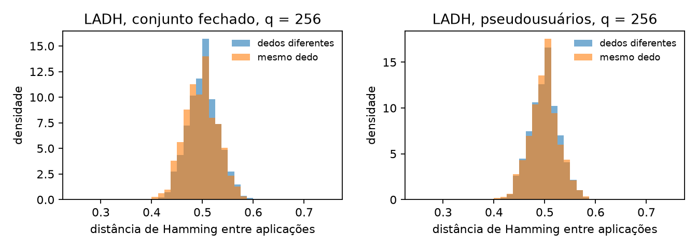

# Templates protegidos por hashing discreto com rótulos

Projeto paralelo, separado do trabalho principal. Ele não entra no artigo, na apresentação nem nas tabelas de
`results/`. Implementa o método de Raja, Raghavendra e Busch, "Towards better and unlinkable protected biometric
templates using label-assisted discrete hashing", IET Biometrics 11(1), 2022, doi
[10.1049/bme2.12043](https://doi.org/10.1049/bme2.12043), e o aplica aos embeddings de impressão digital da
ConvNeXt-Tiny do projeto principal.

## O que o método faz

1. Extrai um vetor de características de cada amostra de cadastro.
2. Aprende um código binário de `q` bits por amostra, minimizando `||qS - BB^T||²`. `S` vale 1 para duas
   amostras do mesmo dedo e 0 caso contrário. O ponto de partida é o XOR de duas matrizes aleatórias geradas
   pelas chaves `k1` e `k2` da aplicação.
3. Aprende uma projeção linear `W` das características para os códigos.
4. O template protegido de qualquer amostra é o sinal de `xW`, em `q` bits. Dois templates são comparados pela
   distância de Hamming.

Trocar as chaves muda os códigos e a projeção, o que renova os templates e impede ligar o mesmo dedo entre duas
aplicações.

## Arquivos

| Arquivo | Conteúdo |
|---|---|
| `ladh.py` | O método: matriz das chaves, otimização dos códigos, projeção, template e distância de Hamming |
| `bloom.py` | Referência do artigo: templates por filtro de Bloom (Rathgeb et al., 2013) |
| `unlinkability.py` | Medida `D_sys` de Gomez-Barrero et al. (2018) |
| `run.py` | Experimento completo; escreve `results/` |
| `test_template_protection.py` | 7 testes unitários |

## Como rodar

O experimento lê os embeddings que o pipeline principal grava em `runs/convnext_tiny_gabor/seed*/` e as divisões
de `protocols/`. Da raiz do repositório:

```bash
uv run --extra cu124 python template_protection/run.py                # cerca de 15 min em CPU
cd template_protection && uv run --extra cu124 pytest -q test_template_protection.py
```

## Protocolo

- Características: embedding de 256 dimensões da ConvNeXt-Tiny com realce de Gabor, três sementes de treino.
- Dedos: os 30 dedos de teste de cada base. Impressões 1 a 4 são o cadastro e 5 a 8 são as sondas. Cada template
  de cadastro é comparado com cada sonda: 480 comparações genuínas e 13.920 impostoras por base.
- Ajuste: o peso da regressão (`lam = 1`) e os tamanhos do filtro de Bloom (palavras de 3 bits, blocos de 4)
  saíram dos 20 dedos de validação da FVC2002 DB1, semente 2026, e valem para tudo (`results/tuning.json`).
- Três pares de chaves por configuração no conjunto fechado; um par no cenário de pseudousuários.

Os números abaixo usam o protocolo de cadastro e sonda desta pasta. Eles não são comparáveis aos do artigo
principal, que usa todos os pares de impressões.

## Resultados

EER em %, média ± desvio das três sementes. Tabela completa, com GMR em três pontos de FMR, em
[results/summary.md](results/summary.md).

| Método | Bits | FVC2002 DB1 | FVC2004 DB1 | D_sys |
|---|---|---|---|---|
| Sem proteção, cosseno | 256 reais | 7,99 ± 0,12 | 8,54 ± 0,51 | |
| Sem proteção, bits de sinal | 256 | 8,39 ± 0,13 | 9,50 ± 0,17 | |
| Filtro de Bloom | 168 | 15,35 ± 0,98 | 17,29 ± 2,53 | 0,07 a 0,08 |
| Proposto, conjunto fechado | 32 | 4,95 ± 1,14 | 4,86 ± 0,61 | 0,06 |
| Proposto, conjunto fechado | 64 | 3,44 ± 0,95 | 3,41 ± 0,43 | 0,07 |
| Proposto, conjunto fechado | 256 | 2,84 ± 0,69 | 2,90 ± 0,42 | 0,05 |
| Proposto, pseudousuários | 64 | 7,52 ± 1,10 | 6,15 ± 0,76 | 0,03 |
| Proposto, pseudousuários | 256 | 6,22 ± 0,70 | 4,99 ± 0,73 | 0,03 |
| Conjunto fechado, impostores nunca cadastrados | 256 | 5,59 ± 0,56 | 3,58 ± 0,12 | |

O padrão do artigo se repete nas impressões digitais:

- O template protegido de conjunto fechado tem EER menor que o embedding sem proteção: 2,8% contra 8,0% na
  FVC2002 DB1 com 256 bits.
- O filtro de Bloom piora o desempenho, de 8% para 15%.
- Com pseudousuários e 64 bits ou mais, a EER fica entre a do conjunto fechado e a do sistema sem proteção.
- `D_sys` fica entre 0,02 e 0,08 em todos os casos. O artigo relata 0,00; aqui o histograma vem de só 240 amostras
  (8 por dedo), e o ruído de amostragem já produz valores dessa ordem.
- Metade dos bits fica ativa (128 de 256), como no artigo.



## Por que o conjunto fechado ganha, e o que isso não prova

No conjunto fechado, a projeção é treinada com os rótulos dos próprios dedos cadastrados, e todo impostor do
teste também é um dedo cadastrado. O hash funciona como um classificador entre os 30 dedos conhecidos, e por isso
supera o embedding. A linha "impostores nunca cadastrados" é um teste que o artigo não faz: 20 dedos são
cadastrados e os outros 10 atacam. A EER sobe de 2,8% para 5,6% na FVC2002 DB1, e a GMR a FMR de 1% cai de 92%
para 60%, abaixo dos 67% do embedding sem proteção. A EER continua abaixo da do embedding sem proteção, mas a GMR a FMR de 1% não. Os dois
testes usam populações diferentes (30 e 20 dedos cadastrados).

## Diferenças em relação ao artigo

| Artigo | Aqui | Motivo |
|---|---|---|
| Características BSIF (histogramas por bloco, 8.192 dimensões) de face e periocular | Embedding de 256 dimensões da ConvNeXt-Tiny, impressão digital | O artigo diz que o método aceita outras características; o objetivo é proteger os templates deste projeto |
| `S` em {-1, 1} na Seção 2.2 e 0 para os demais na nota 2 | `S` em {0, 1} | Com -1, as linhas fora da amostra de colunas colapsam num único código quando há 4 amostras por dedo |
| Otimização "como em Kang et al." (COSDISH), sem detalhes | Amostragem de colunas, problema binário por bit resolvido por subida de coordenadas, 5 iterações | A aproximação 2 do COSDISH não está descrita no artigo |
| Equações 4 e 5 definem os bits por `i >= k` | Matriz normal com semente `k`, limiarizada em zero | As equações não fecham como estão; o texto fala em matrizes normais binarizadas |
| 94 pessoas, 5 cadastros e 10 sondas | 30 dedos, 4 cadastros e 4 sondas | FVC tem 8 impressões por dedo |
| Pseudousuários: 50 pessoas da FRGC v2 | 50 dedos da mesma base, fora do teste, impressões 1 a 4 | Mesma modalidade e sensor |
| Taxa de remapeamento (`rm-rate`) | Não calculada | É definida para as palavras do filtro de Bloom |
| GMR a FMR de 0,01% | Também a 1% e 0,1% | Com 13.920 impostores, 0,01% corresponde a um único par |

Como no artigo, a segurança supõe que a projeção `W` fica protegida. Este projeto não testa o que acontece
quando ela vaza.
